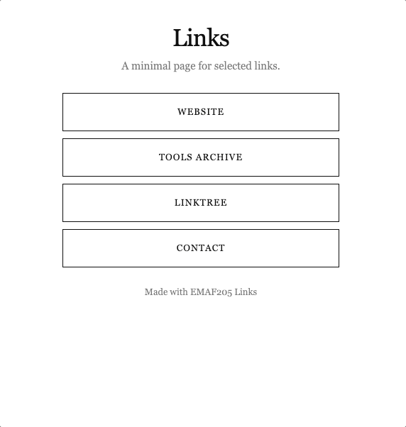

# Easy Personal Linktree

**Your links. Your website. No subscriptions.**

A free, self-hosted Linktree alternative built with PHP. Create a simple personal links page for your social media bio, portfolio, projects, or contact links. Upload three files to your website and edit plain-text settings whenever you want to change the content or colors.

No account, database, or third-party link-page service required.

## Preview



## Files

```text
index.php          Main page and built-in layout
page.txt           Title, description, links, and footer
style.txt          Colors and font settings
assets/preview.gif README preview only; not needed on your server
```

## Installation

1. Download the files and keep the names `index.php`, `page.txt`, and `style.txt`.
2. Edit `page.txt` with your title, description, and links. Optionally edit `style.txt`.
3. Upload the three files to the **same folder** on a web hosting service that supports PHP (for example, `public_html/links/`) using FTP.
4. Open your page, for example: `https://yourdomain.com/links/`.

The preview GIF is only for this README; you do not need to upload it to your hosting.

## Edit your links

Open `page.txt` in a text editor. One button looks like this:

```text
ITEM: website
TITLE: My Website
URL: https://example.com
TARGET: _blank
```

Copy the four-line block to add more buttons. `ITEM` is an internal label, `TITLE` is the button text, and `URL` is its destination. Use `TARGET: _blank` for a new tab or `TARGET: _self` for the same tab. You can use `mailto:` links for email.

Other settings:

```text
SITE_TITLE: My Links
SITE_DESCRIPTION: Find me online.
FOOTER_TEXT: Made with Easy Personal Linktree
```

Leave `FOOTER_TEXT` empty to hide the footer. Lines starting with `#` are comments.

## Change the appearance

Edit `style.txt`; leave fields blank to use the default minimalist design.

```text
BACKGROUND_COLOR: #ffffff
TEXT_COLOR: #111111
FONT: serif
BUTTON_BACKGROUND: #ffffff
BUTTON_TEXT_COLOR: #111111
BUTTON_BORDER_COLOR: #111111
```

Use HEX colors (`#fff` or `#ffffff`). Available fonts are `serif` and `sans`. The buttons have a square, uppercase style; the CSS layout is built into `index.php`.

## Requirements

- Web hosting with PHP support.
- FTP access or another way to upload files.
- No database or build step.

## License

MIT License, as stated in the source header. Keep the attribution header when redistributing the PHP source.

Created by **EmaF205** in Milan.
