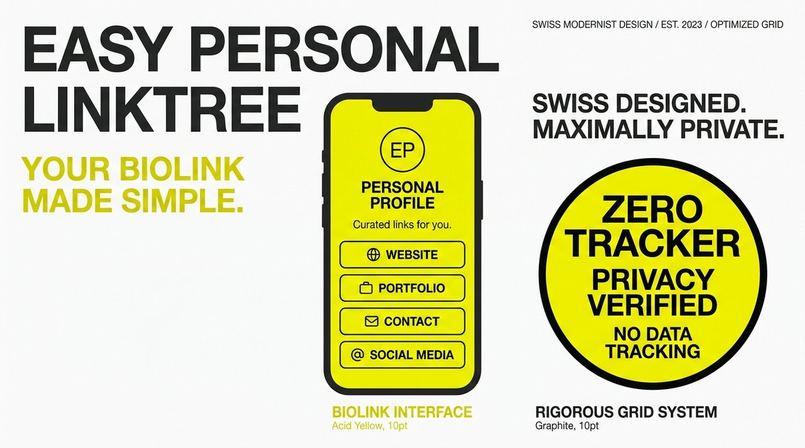

# Easy Personal Linktree // Minimalist Bio Link Hub

<p align="center">
  
</p>

> **Ultra-clean, zero-dependency personal bio link hub and responsive mobile directory for creators, designers, and developers.**

---

## Overview

**Easy Personal Linktree** is an uncompromising, minimalist alternative to bloated commercial link-in-bio services. Built with pure vanilla HTML and CSS, it loads in under 50 milliseconds, respects user privacy completely, and provides an authoritative personal presence tailored for mobile screens and desktop viewports alike.

---

## Why Use This?

- **Zero Bloat & Zero Trackers**: No third-party analytics, cookies, or JavaScript trackers.
- **Lightning Fast (<50ms)**: Single-digit kilobyte payload that renders immediately on all devices.
- **Mobile-First Tactile UX**: Optimized 48px+ touch targets designed for fluid one-handed navigation.
- **Effortless Configuration**: Single HTML file with semantic markup and CSS custom properties (`:root`).
- **Host Anywhere**: Ready for instant deployment on GitHub Pages, Netlify, Vercel, Apache, or traditional FTP.

---

## Quick Setup

1. Clone the repository:
   ```bash
   git clone https://github.com/emaf205/EASY-PERSONAL-LINKTREE.git
   ```
2. Unpack `easy-personal-linktree-github.zip` or open `index.html`.
3. Customize your links, avatars, and social handles in the HTML structure:
   ```html
   <a href="https://yourwebsite.com" class="link-card" target="_blank" rel="noopener">
     <span class="link-title">Primary Portfolio</span>
     <span class="link-subtitle">Selected works & case studies</span>
   </a>
   ```
4. Upload `index.html` and assets to your web root or host via GitHub Pages.

---

## Styling & Customization

All visual tokens are defined via native CSS variables:
```css
:root {
  --bg-color: #0d0e12;
  --card-bg: #16181f;
  --card-border: #242733;
  --text-main: #f0f2f5;
  --accent-color: #ff3b30;
}
```

---

## License & Attribution

Crafted by **Emanuele BDC (EmaF205)**.  
Released under the [MIT License](LICENSE).
